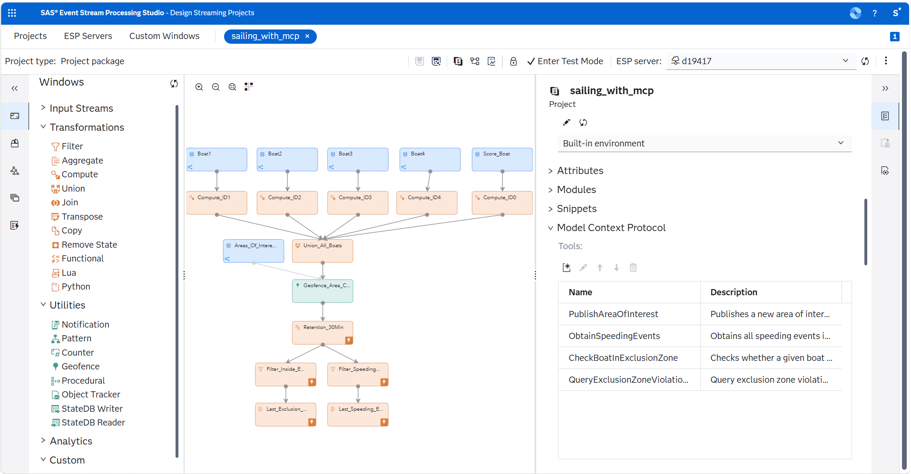
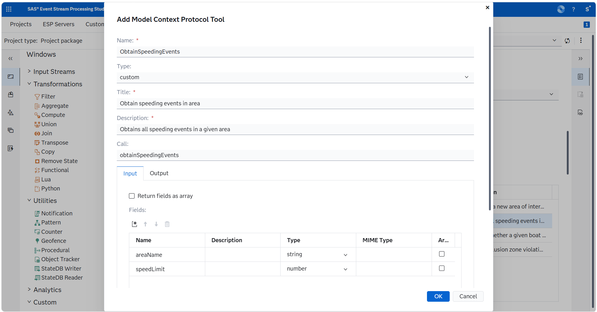
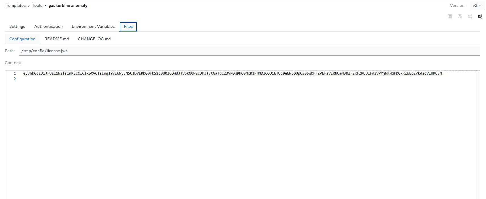
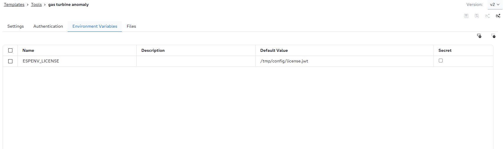

# Power AI Agents with Real-time Analytics & AI using Model Context Protocol (MCP)

## Why use ESP MCP with LLMs?

SAS Event Stream Processing (ESP) processes streaming data in real time. With MCP, business users and analysts can ask an AI agent for live operational insights in natural language, without needing to understand the underlying event streams, data model, or project logic. Because the agent works through ESP, its answers are grounded in trusted, up-to-date data and AI. This reduces hallucinations and outdated answers. ESP projects are governed and versioned, and the results they return are (usually) deterministic.

Model Context Protocol (MCP) closes the gap between language models and live operational systems by allowing an ESP project to expose its project logic and operations as structured, discoverable capabilities:

- Tools for actions such as publishing data, querying state, or scoring models
- Prompts that package common tasks and expected inputs
- Apps that provide chatbots with a rich user interface

Through these primitives, ESP MCP enables an MCP client (such as an LLM) to combine:

- real-time streaming analytics that reflect what is happening right now,
- the project logic and AI models that already exist in ESP, without rebuilding them for GenAI use,
- tools that are exposed in a consistent, discoverable way and described in business terms,
- and a governed set of actions, where the MCP client can only invoke what the project explicitly exposes.

That is the value of ESP MCP: it allows AI systems to work with live data pipelines and decision logic, rather than substituting a generic chat interface for a real-time analytics engine.

This example uses the sailing use case to demonstrate that pattern in a practical way. It shows how a boat telemetry stream can be translated into MCP tools that an LLM can use to answer questions or trigger actions against the project.

## Use Case

This example is based on the sailing example, which identifies two geographic areas of interest:

- a dockyard exclusion zone that boats are not permitted to enter
- a marina where a speed restriction is applied

The project reads boat telemetry from CSV files and processes it through a sequence of windows that:

- ingest boat positions,
- unify and enrich events,
- evaluate whether a boat is inside the exclusion zone,
- detect speeding events,
- retain recent state and aggregate important outcomes.

The MCP layer adds an AI-friendly interface on top of that project. It exposes reusable operations for an MCP client such as Claude, ChatGPT, VS Code, or SAS Retrieval Agent Manager.

The project contains several preconfigured MCP tools:

- PublishAreaOfInterest: publishes a new area-of-interest event into the Areas_Of_Interest stream
- QueryExclusionZoneViolations: queries recent exclusion-zone data from the relevant window
- ObtainSpeedingEvents: filters retained boat data using area name and speed threshold and returns the results
- CheckBoatInExclusionZone: submits a boat position to a scoring flow and returns whether that point is inside the exclusion zone

The ESP project also includes Python snippet logic for these operations. The logic is not the focus here; the main point is that the same business logic that runs in the streaming model can also be surfaced to AI clients through MCP.

For a more detailed description of the underlying sailing workflow, see the [sailing example](../sailing/README.md).

## MCP concepts in ESP Studio

At a high level, ESP supports three common MCP primitives:

- Tools: actions that the MCP client can call to perform work in the ESP project
- Prompts: predefined instructions or task templates that package common user tasks
- Apps: reusable user interfaces or task flows surfaced to the MCP client

In this example, the primary focus is on tools. However, the same project can also be used as a foundation for prompts and apps in real deployments.

The key idea is that an LLM does not need to know how to operate the ESP project directly. The LLM only needs to know which MCP tools are available, what they do, and what inputs they expect. By adding semantic descriptions of the operational context, people can ask questions the way they think: not "Which events are in my_window?" but "Which boats are speeding?" The agent interprets the intent, picks the right tool, calls it, interprets the result, and continues the workflow.

### ESP Studio: adding MCP tools and apps

In ESP Studio, MCP settings are configured in the Model Context Protocol section within the project pane. The typical flow is:

1. Design the ESP project and define its windows and logic.
2. Configure one or more MCP tools to expose the project actions.
3. Optionally define MCP apps and prompts for common use cases.
4. Run the project so the ESP server's MCP endpoint is exposed.
5. Connect an MCP client to that endpoint.

MCP tools, along with apps and prompts, are visible and configurable in the Model Context Protocol section within the project pane:


An MCP tool is configured through a dialog which allows you to specify the name, description, type, and other aspects of the tool as appropriate:



## Where the MCP endpoint is exposed

When the project is running, the ESP server exposes an MCP endpoint at:

- `/eventStreamProcessing/v2/mcp`

The exact URL depends on how and where the project is deployed. In a local developer setup it can be a local machine endpoint. For example, in an ESP Project Container:

- `http://localhost:31415/eventStreamProcessing/v2/mcp`

In a Kubernetes deployment, it can be a cluster-exposed endpoint behind the SAS Event Stream Processing service route or an ingress path. In a production deployment, the full address typically looks like this:

- `https://<host>/SASEventStreamProcessingServer/<server-prefix>/eventStreamProcessing/v2/mcp`

The server prefix can be found depending on how the project is started:
- For projects started in ESP Studio test mode, the host value of the project in the ESP Servers tab
- For projects started in ESM, the Source value found in the expanded project when viewing the ESP server

For example:

- `https://<host>/SASEventStreamProcessingServer/sailing_with_mcp/eventStreamProcessing/v2/mcp`

## Deployment strategies

The same ESP project can be exposed through different deployment patterns. The main distinction is whether the project is running on a local machine or in a Kubernetes-based environment.

### Option 1: ESP Project Container

This is the simplest way to test MCP with a local MCP client such as VS Code. An ESP Project Container built around this MCP example project must be available. See [SAS Help Center: Creating Project Containers](https://helpcenter.unx.sas.com/test/doc/en/espcdc/v_078/esmuse/p1lpbl7fvj9ivln1mjixi4hdrnu7.htm) for more details.

Typical setup steps:

1. Start the ESP Project Container containing the MCP example project from the command line. As part of the start command, the 31415 port should be published to the host machine. For example:
   ```
   docker run \
     -p 31415:31415 \
     -e ESPENV_LICENSE="$ESPENV_LICENSE" \
     -h localhost \
     --env=SAS_ESP_SERVER_BASE_URL=http://localhost:31415 \
     <your-project-container-image>
   ```
2. The ESP Project Container exposes the MCP endpoint at a local URL, i.e. `http://localhost:31415/eventStreamProcessing/v2/mcp`.
3. Point your MCP-capable client to the local MCP endpoint. The MCP client must be able to reach local URLs.

This setup works well for local development because:

- there is no port forwarding requirement,
- the client and server are on the same machine or the same secure local network

The ESP Project Container can also be used in SAS Retrieval Agent Manager as part of a container tool template. Typical setup steps:

1. Create a new container tool template.
2. Supply the URL relating to the ESP Project Container.
3. Set the Port to 31415.
4. Set the Base Path to `eventStreamProcessing/v2/mcp`.
5. Add your ESP JWT license file in the Files tab:
   
6. Set the ESPENV_LICENSE environment variable to the path of the license file in the Environment Variables tab:
   

### Option 2: Kubernetes deployment using ESP Studio or Event Stream Manager

For a Kubernetes deployment, the project typically runs in SAS Event Stream Processing in a cluster or a project container environment. ESP Studio Test mode is a useful method of running the project for testing purposes; persistent deployment suitable for production can be achieved through Event Stream Manager (ESM) or other deployment methods.

Typical setup steps:

1. Open SAS Event Stream Processing Studio and import or install the example project.
2. Use ESP Studio or Event Stream Manager to run the project.
3. Confirm the ESP server's route is available in the cluster's internal or external network.
   - For an MCP client to access the ESP server, the ESP server must be exposed through the cluster's external HTTP routing. Configure the cluster's ingress or equivalent routing mechanism to route requests from the external cluster hostname to the Kubernetes Service for the ESP server.
   - Identify the service name for the running ESP project. In Kubernetes deployments, this is derived from the project name and may be encoded. The service/host name can be obtained from ESP Studio or Event Stream Manager.
   - Use this service name to construct the external MCP endpoint: `https://<host>/SASEventStreamProcessingServer/<service-name>/eventStreamProcessing/v2/mcp`
   - Verify that this URL is reachable from outside the Kubernetes cluster before configuring the MCP client. A production deployment should use this externally routed endpoint rather than Kubernetes port forwarding.
4. Connect the MCP client to the MCP server endpoint.

This deployment model is useful when the project is intended to be accessed by multiple clients.

Important: If the cluster is protected by SSL, the MCP client must be able to trust the cluster's certificate authority or have the appropriate CA certificates installed.

## How to connect clients to the MCP endpoint

The process to connect to the MCP endpoint differs depending on both the nature of the deployment, and the chosen MCP client.

### Public remote MCP
Claude Desktop, ChatGPT, and other common MCP clients can connect to the MCP endpoint if it is exposed to the public internet and available over HTTPS with a publicly-trusted certificate. ESP authentication is still required; this is provided by an automated OAuth2 flow which is supported by major MCP clients.

Details of how to configure the MCP client to connect to the MCP server are provided by the client vendor:
- For ChatGPT, see [OpenAI: Connecting custom MCP servers in ChatGPT](https://help.openai.com/en/articles/12584461-connecting-custom-mcp-servers-in-chatgpt)
- For Claude Desktop, see [Claude Support: Get started with custom connectors using remote MCP](https://support.claude.com/en/articles/11175166-get-started-with-custom-connectors-using-remote-mcp)

### Private remote MCP and locally-hosted MCP
In cases where the MCP endpoint is not publicly accessible, such as where:
- the environment in which the ESP project is running is in a private network or behind a firewall
- the environment is protected with a self-signed certificate or a private CA
- the ESP project is running as a project container or on a local machine,

MCP clients such as Claude Desktop and ChatGPT are unable to reach the MCP endpoint in these instances, as MCP calls made by these clients are routed through the vendor's cloud infrastructure. Both vendors offer solutions for connecting to a private/locally-hosted remote MCP server:
- For ChatGPT, OpenAI offers a "Secure MCP Tunnel" solution, which enables ChatGPT and other OpenAI products to communicate with the MCP server through your local machine. See [OpenAI Developers: Secure MCP Tunnel](https://developers.openai.com/api/docs/guides/secure-mcp-tunnels) for details.
- Anthropic currently does not provide an official solution for Claude Desktop. Third party solutions that aim to proxy remote MCP calls as local stdio for Claude Desktop are available, but these are not officially supported by Anthropic. See [GitHub: MCP Bridge](https://github.com/skroutz/mcp-bridge) for details.

### SAS Retrieval Agent Manager (RAM)

SAS Retrieval Agent Manager is particularly relevant because it is designed for orchestrated, workflow-style agent use cases that can combine retrieval and tool execution.

Typical steps:

1. Ensure the ESP server has the `SAS_ESP_SERVER_BASE_URL` environment variable set to the correct base URL for the ESP server.
2. In SAS Retrieval Agent Manager, create a new MCP Tool Server and select the Remote MCP Server template.
3. Provide the URL to the ESP server's MCP endpoint, e.g. `https://<host>/SASEventStreamProcessingServer/<server-prefix>/eventStreamProcessing/v2/mcp`.
4. Set Transport to HTTP.
5. Let SAS Retrieval Agent Manager discover the tools exposed by the ESP project.

For more information on configuring MCP servers in SAS Retrieval Agent Manager, see [SAS Retrieval Agent Manager: Adding an MCP Tool Server](https://helpcenter.unx.sas.com/test/doc/en/ragntmgrcdc/v_014/ragntmgrug/n05qjlu6s349yhn1sfa0nbvo31ad.htm).

### VS Code

Remote MCP connections can be configured in VS Code and made available to the integrated GitHub Copilot chat feature. MCP calls originate directly from the VS Code environment, allowing any reachable MCP server to be used even if it is not publicly accessible.

Typical steps:

1. In VS Code, open the Copilot chat pane, and click the "Open Customizations" button. Alternatively, run **Chat: Open Customizations** from the command palette.
2. In the Customizations dialog, navigate to the **MCP Servers** section.
3. Click the "Add Server" button in the **User** group.
4. Choose **HTTP (HTTP or Server-Sent Events)** and enter the MCP server endpoint.
5. Enter a name for the MCP connection.
6. Select **Global**, then **Copilot Global**.

## Testing the connection

The easiest way to validate the MCP endpoint before connecting an LLM client is to use the MCP Inspector.

The Model Context Protocol documentation provides a useful inspector for testing server connections and tool exposure:

- https://modelcontextprotocol.io/docs/2026-07-28/tools/inspector

This is valuable because it lets you validate:

- the endpoint is reachable,
- the server exposes the expected tools,
- the input and output schema are correct,
- and the MCP client can call the tools successfully.

The inspector also supports apps as well as tools in current MCP implementations, so it is a good practical validation utility for both.

## Project files

The project contains the following files:

- [model.xml](model.xml): the ESP project definition, including the configured MCP tools
- [boat1.csv](boat1.csv), [boat2.csv](boat2.csv), [boat3.csv](boat3.csv), [boat4.csv](boat4.csv): boat telemetry input streams
- [geoArea.csv](geoArea.csv): geographic areas-of-interest input
- [README.md](README.md): project documentation

## Additional resources

- [SAS Event Stream Processing Studio Examples](https://github.com/sassoftware/esp-studio-examples)
- [Model Context Protocol documentation](https://modelcontextprotocol.io/)
- [MCP Inspector](https://modelcontextprotocol.io/docs/2026-07-28/tools/inspector)
- [SAS Event Stream Processing documentation](https://documentation.sas.com/doc/en/espcdc/default/home.htm)
- [The sailing example](../sailing/README.md)
